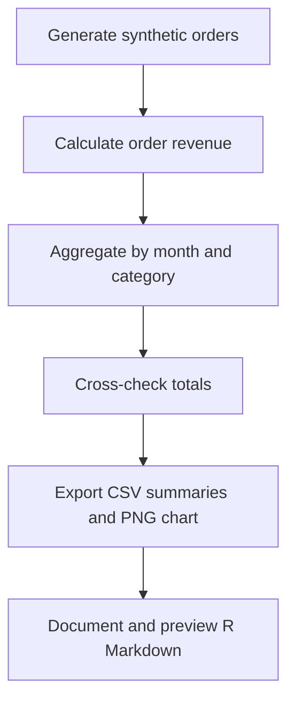

# Markdown Buddy: Synthetic Retail Sales Analysis in R

> **AI Assistance Declaration:** I used ChatGPT (OpenAI GPT-6, October 26, 2026) for documentation structure, drafting, formatting suggestions, and example R code scaffolding. Prompts are recorded in `AI_Prompts_Appendix.md`. I must verify the outputs using GitHub Markdown preview, an R Markdown knit, independent checks of R results, and manual spot-checks before submission. All final calculations must be run and checked by me. I am responsible for the accuracy and originality of this work.

## Overview
A small, reproducible demonstration of documenting an R data analysis project. The project generates **synthetic** retail transactions, calculates monthly and category revenue, and exports a chart and CSV summaries. It uses no real customer data.

## Goals
- Demonstrate a clear GitHub README and a structured R Markdown report.
- Show transparent inputs, outputs, and basic validation.
- Document the use and limitations of AI-assisted writing.

## Repository structure
```text
markdown-buddy-Dhyey/
├── README.md
├── R/
│   └── sales_analysis.R
├── docs/
│   └── Sales_Analysis_Documentation.Rmd
├── Reflection.md
├── AI_Prompts_Appendix.md
└── outputs/                  # generated locally when the script runs (not committed)
```

## Requirements and installation
Install [R](https://cran.r-project.org/) and optionally [RStudio](https://posit.co/download/rstudio-desktop/). The script uses **base R only**. To knit the report, install `rmarkdown` and a compatible Pandoc installation (included with RStudio in typical setups):

```r
install.packages("rmarkdown")
```

## Example usage
From the project root, open RStudio and run:

```r
source("R/sales_analysis.R")
rmarkdown::render("docs/Sales_Analysis_Documentation.Rmd")
```

The script creates `outputs/` automatically. The report re-runs the script and describes its inputs and outputs. **Run commands from the project root** so relative paths resolve correctly. The R Markdown setup chunk sets its knit working directory to the project root.

## Data and methods
The dataset has 120 simulated orders across four months and three product categories. A fixed random seed makes the randomly sampled unit counts reproducible. Revenue per order is `units * unit_price`. Base R `aggregate()` produces the monthly and category totals. This is a demonstration, not an estimate of real retail performance.

## Workflow


## Outputs
| File | Purpose |
| --- | --- |
| `outputs/monthly_revenue.csv` | Monthly revenue summary |
| `outputs/category_revenue.csv` | Category revenue summary |
| `outputs/monthly_revenue.png` | Monthly revenue bar chart |

## Validation and limitations
The script checks order count, nonnegative revenue, and agreement between the raw total and both summary totals. Additional independent manual checks and preview/knit verification are required before submission. The data are synthetic, cover only four months, and cannot support real-world business conclusions.

## License
Educational demonstration. No third-party dataset is redistributed. No open-source license is granted unless a license file is added by the repository owner.

## References
- [GitHub: Basic writing and formatting syntax](https://docs.github.com/en/get-started/writing-on-github/getting-started-with-writing-and-formatting-on-github/basic-writing-and-formatting-syntax)
- [R Markdown: The Definitive Guide](https://bookdown.org/yihui/rmarkdown/)
- [tidyverse organization on GitHub](https://github.com/tidyverse)

## AI Assistance Disclosure
ChatGPT (GPT-6, October 26, 2026) assisted with the README outline, wording, R Markdown organization, and illustrative R script. Main prompts: “Explain what sections a good GitHub README for an R data analysis project should include”; “Generate a professional README for a synthetic retail sales analysis in R”; “Review Markdown syntax and suggest two clarity improvements.” The draft was revised to add explicit dependencies, relative-path instructions, synthetic-data safeguards, a validation section, and an accurate license statement. See `AI_Prompts_Appendix.md` for prompt details. **The repository owner must personally verify rendering and calculations.**
